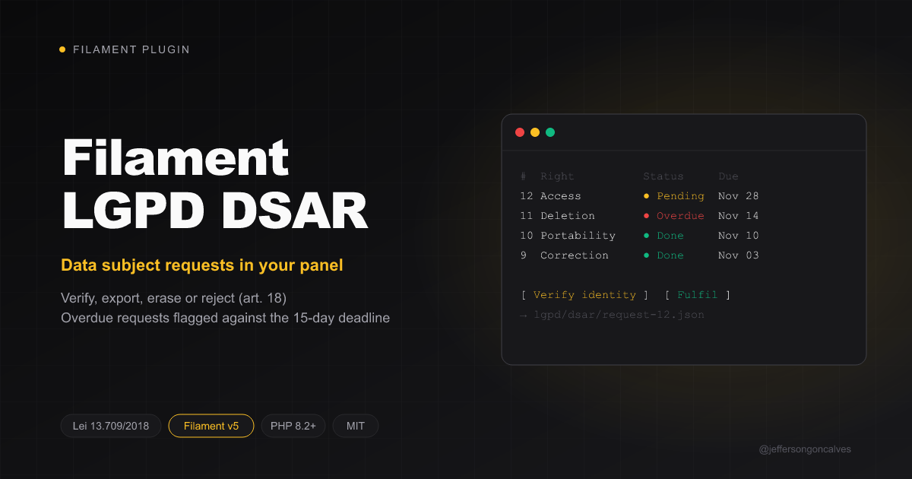

<div class="filament-hidden">



</div>

# Filament LGPD DSAR

[](https://packagist.org/packages/jeffersongoncalves/filament-lgpd-dsar)
[](https://github.com/jeffersongoncalves/filament-lgpd-dsar/actions?query=workflow%3Atests+branch%3A2.x)
[](https://github.com/jeffersongoncalves/filament-lgpd-dsar/actions?query=workflow%3A"Fix+PHP+code+styling"+branch%3A2.x)
[](https://packagist.org/packages/jeffersongoncalves/filament-lgpd-dsar)
[](LICENSE.md)

A Filament panel for the data subject requests of the Brazilian General Data Protection Law (LGPD, art. 18). It is the UI of [laravel-lgpd-dsar](https://github.com/jeffersongoncalves/laravel-lgpd-dsar): every action calls that package, so the rules it enforces (verify first, automatic types only, 15-day deadline) stay in one place.

## Features

- Register a request for any of the 9 rights of art. 18. The deadline is set from `lgpd-dsar.deadline_days`.
- **Verify identity:** link the request to the data subject's record. Nothing is exported or erased before this.
- **Fulfil** access and portability (JSON export, downloadable from the request) and anonymization and deletion (erases the subject's records).
- **Complete** the rights answered by hand (confirmation, correction, sharing information...) with the response you gave, or **reject** with a reason.
- Overdue requests in red, an "Overdue" filter, and a navigation badge with open requests (red when one is overdue).
- 19 languages.

## Compatibility

| Plugin Version                                                          | Filament |
|-------------------------------------------------------------------------|----------|
| [1.x](https://github.com/jeffersongoncalves/filament-lgpd-dsar/tree/1.x) | 3.x      |
| [2.x](https://github.com/jeffersongoncalves/filament-lgpd-dsar/tree/2.x) | 4.x      |
| [3.x](https://github.com/jeffersongoncalves/filament-lgpd-dsar/tree/3.x) | 5.x      |

## Installation

You can install the package via composer:

```bash
composer require jeffersongoncalves/filament-lgpd-dsar:"^2.0"
php artisan vendor:publish --tag="lgpd-dsar-migrations"
php artisan migrate
```

Set up [laravel-lgpd](https://github.com/jeffersongoncalves/laravel-lgpd) first: the models listed in `lgpd.models` are the ones a request can be linked to, exported and erased.

## Usage

```php
use JeffersonGoncalves\Filament\LgpdDsar\LgpdDsarPlugin;

public function panel(Panel $panel): Panel
{
    return $panel
        ->plugins([
            LgpdDsarPlugin::make()
                ->navigationGroup('LGPD')                 // default: no group
                ->navigationSort(10)
                ->navigationIcon('heroicon-o-shield-check')
                ->slug('data-subject-requests')
                ->subjectModels([User::class]),           // default: lgpd.models
        ]);
}
```

All fluent methods are optional. The export disk and the deadline are configured in laravel-lgpd-dsar's `lgpd-dsar` config. Keep the export disk private: the file holds the data subject's personal data.

> The resource has no authorization of its own: register it only on panels whose users handle privacy requests, or add a policy for `JeffersonGoncalves\LgpdDsar\Models\DataSubjectRequest`.

## Testing

```bash
composer test
```

## Changelog

Please see [CHANGELOG](CHANGELOG.md) for more information on what has changed recently.

## Contributing

Please see [CONTRIBUTING](.github/CONTRIBUTING.md) for details.

## Security Vulnerabilities

Please review [our security policy](../../security/policy) on how to report security vulnerabilities.

## Credits

- [Jefferson Gonçalves](https://github.com/jeffersongoncalves)
- [All Contributors](../../contributors)

## License

The MIT License (MIT). Please see [License File](LICENSE.md) for more information.
